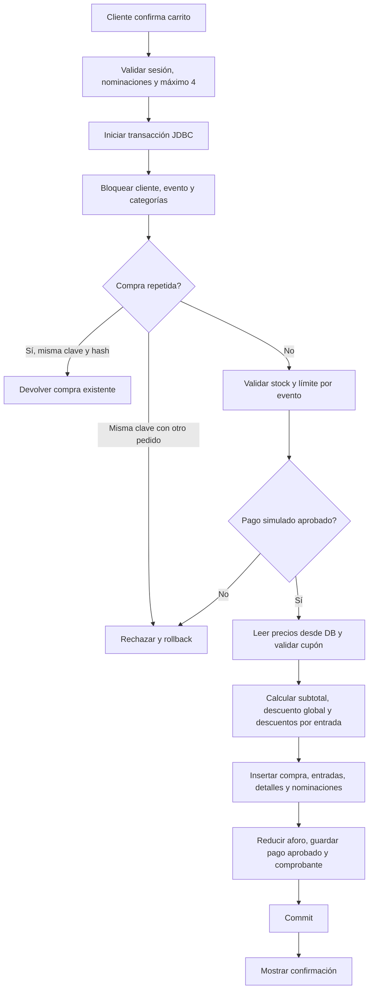
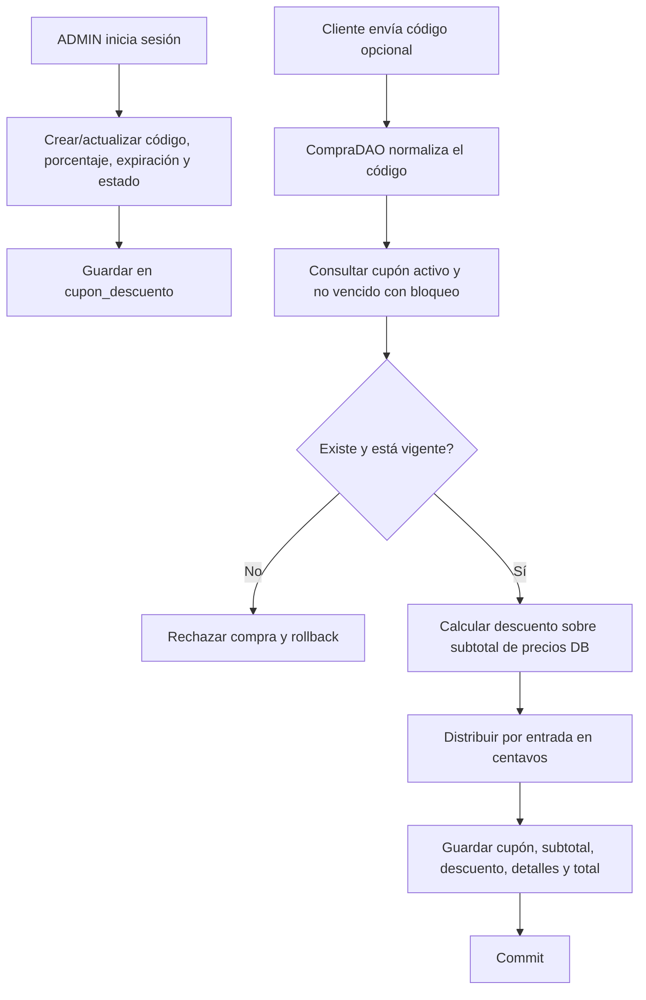
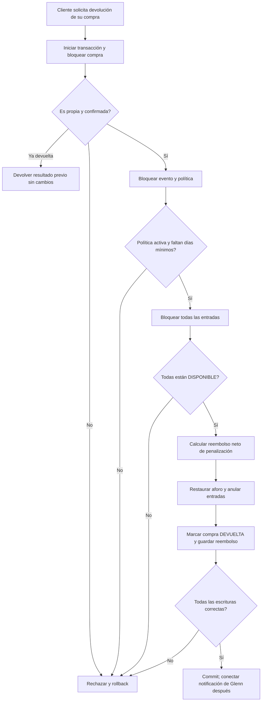

# Informe de implementación — módulo de Ethan

## 1. Funciones que ya estaban implementadas

- La base ya incluía las tablas y relaciones para cupones, políticas de devolución, compras, detalles, pagos, entradas y nominaciones.
- El checkout existente obtenía los precios del servidor, agrupaba la compra en una transacción JDBC, bloqueaba cliente/evento/categorías, reducía el aforo y protegía el reintento con una clave y un hash de solicitud.
- El límite de cuatro entradas por cliente y evento ya se verificaba en el servidor.
- La compra confirmada generaba entradas, detalles, nominaciones, pago simulado aprobado y comprobante académico.
- Ya existían las vistas iniciales para administrar cupón/política y solicitar una devolución por ID.

## 2. Funciones corregidas

- Se completó `detalle_transaccion.descuento_aplicado`: el descuento calculado por el servidor ahora se distribuye por boleto en centavos, su suma coincide exactamente con el descuento global y nunca supera el precio aplicado. Se conserva el redondeo monetario a dos decimales.
- Se corrigió el número de parámetros del `INSERT` de compra que causaba `Parameter index out of range`.
- Se corrigió la comprobación de rol/CSRF del administrador: una sesión no autorizada redirige al acceso administrativo y un CSRF incorrecto produce 403 sin sobrescribir una redirección.
- Se añadieron getters JavaBean a los resultados tipo `record` que se muestran en JSP; EL de Tomcat no reconocía sus accessors de record y causaba HTTP 500 en el panel y el resultado de devolución.
- Se validan los campos requeridos de administración antes de persistirlos; los errores SQL se registran en el servidor y no se muestran como detalles internos al usuario.
- La devolución ahora requiere sesión de cliente también en GET. La confirmación de compra muestra el ID y enlaza directamente al formulario propio de devolución.
- El reintento de devolución mantiene la respuesta existente sin volver a anular entradas ni restaurar cupos.

## 3. Funciones implementadas o completadas

- Gestión de cupones por código: alta/actualización, porcentaje, vencimiento y estado activo/inactivo. El panel lista valor, fecha de expiración y estado.
- Políticas por evento: alta/actualización por ID de evento, plazo mínimo en días y penalización; el panel lista la configuración vigente.
- Validación de cupón en la transacción: existencia, activo, vencimiento y porcentaje se consultan en base de datos. El cliente no controla el subtotal, descuento ni total.
- Pago simulado aprobado/rechazado. Un rechazo aborta antes de guardar compra, entrada, pago o cambio de aforo.
- Devolución completa de compra propia: verifica política, plazo, estado de todas las entradas y propiedad; calcula reembolso, marca entradas anuladas y recupera cupos dentro de una transacción.
- Acceso administrativo separado para no confundir al administrador con el personal de validación. La sesión se renueva tras autenticar rol `ADMIN`; el acceso anterior de guardia conserva su comportamiento.
- Cuenta de administración ficticia exclusivamente para la instalación demo local.
- Las notificaciones siguen fuera del alcance de Ethan. Glenn puede conectar su módulo después del commit de compra exitosa y después del commit de devolución; no se envía notificación antes de confirmar la transacción.

## 4. Archivos modificados y creados

- `src/main/java/pe/edu/utp/eventope/dao/CompraDAO.java`: asignación por entrada del descuento total.
- `src/main/java/pe/edu/utp/eventope/controller/EthanAdministracionServlet.java`: controles de rol/CSRF y validación del formulario.
- `src/main/java/pe/edu/utp/eventope/controller/EthanAdminLoginServlet.java`: nuevo acceso autenticado para el administrador Ethan.
- `src/main/java/pe/edu/utp/eventope/service/ServicioAutenticacion.java`: autenticación explícita de administradores; el método de personal de validación no cambia.
- `src/main/java/pe/edu/utp/eventope/controller/DevolucionServlet.java`: protege GET para sesión de cliente y agrega `no-store`.
- `src/main/webapp/WEB-INF/views/admin/login.jsp`: nuevo formulario de administración.
- `src/main/webapp/WEB-INF/views/admin/ethan.jsp`: listados de cupones y políticas.
- `src/main/webapp/WEB-INF/views/compras/confirmacion.jsp`: ID de compra y enlace a su devolución.
- `src/test/java/pe/edu/utp/eventope/CompraMySqlTest.java`: verifica suma y límite del descuento en los detalles.
- `src/test/java/pe/edu/utp/eventope/EthanCompraDevolucionMySqlTest.java`: pruebas MySQL aisladas de compra, cupón, pago y devolución.
- `sql/07_ethan.sql`: cupón/políticas demo y administrador local ficticio; no agrega ni reconstruye tablas.
- `README.md`: pasos SQL, rutas y credenciales ficticias.
- `docs/ETHAN_IMPLEMENTACION.md`: este informe, diagramas, diccionario y evidencia.

## 5. Base de datos y entidades

No se requieren `ALTER TABLE` ni reconstrucción de esquema. Ejecutar `sql/07_ethan.sql` después de `sql/01_esquema.sql` y `sql/02_datos_demo.sql`. El script es idempotente para los datos que inserta; no borra compras ni clientes.

Relaciones y restricciones verificadas en `sql/01_esquema.sql`:

- `CuponDescuento` / `cupon_descuento`: PK `id`, código único, porcentaje entre 0–100 y estado `ACTIVO`/`INACTIVO`. Una compra puede referenciar el cupón por FK nullable.
- `PoliticaDevolucion` / `politica_devolucion`: PK `id`, FK/clave única `evento_id`, días no negativos y penalización entre 0–100.
- `TransaccionCompra` / `transaccion_compra`: PK `id`, código único, hash de solicitud, FK a cliente/evento/cupón, importes decimales y estados `CONFIRMADA`/`DEVUELTA`.
- `DetalleTransaccion` / `detalle_transaccion`: PK `id`, FK de compra y entrada; `entrada_id` es único. `descuento_aplicado` debe estar entre cero y `precio_aplicado`.
- `MetodoPago` / `metodo_pago`: PK `id`, relación única con compra, operación única y restricción `estado_transaccion='APROBADO'`. Un pago rechazado no se inserta.
- `entrada_digital.estado_uso` acepta `DISPONIBLE`, `UTILIZADA` o `ANULADA`; categoría y evento tienen FK. La transacción JDBC del servicio garantiza que detalles, entradas, pago y aforo no queden a medias.

### Documentación de las cinco clases asignadas

| Clase | Responsabilidad y persistencia |
|---|---|
| `CuponDescuento` | Campos: `id`, `codigoCupon`, `porcentajeDescuento`, `fechaExpiracion`, `estado`. Administración escribe los datos; `CompraDAO` consulta y bloquea el cupón activo/vigente al confirmar. |
| `PoliticaDevolucion` | Campos: `id`, `eventoId`, `diasMinimosPrevios`, `penalizacionPorcentaje`, `estadoActivo`. Administración la actualiza por evento; `DevolucionDAO` la bloquea y aplica durante la devolución. |
| `TransaccionCompra` | Campos: `id`, `codigoUnico`, `solicitudHash`, `clienteId`, `eventoId`, `cuponId`, `fechaHora`, `subtotal`, `descuento`, `igv`, `total`, `estado`, `importeReembolso`, `fechaReembolso`. Se inserta o actualiza desde `CompraDAO`/`DevolucionDAO`. |
| `DetalleTransaccion` | Campos: `id`, `transaccionId`, `entradaId`, `precioAplicado`, `descuentoAplicado`. Vincula la entrada a su compra y `obtenerImporteNeto()` obtiene su valor neto; la suma de descuentos coincide con el descuento de la transacción. |
| `MetodoPago` | Campos: `id`, `transaccionId`, `nombreMetodo`, `nroOperacion`, `estadoTransaccion`. Conserva el pago académico aprobado. No procesa tarjetas ni representa una pasarela bancaria. |

Los modelos son datos; las reglas y transacciones residen en servicios/DAO. La base no tiene una tabla de compra rechazada.

## 6. Diagramas actualizados

### Compra y pago



### Gestión y aplicación de cupones



### Devolución



## 7. Pruebas ejecutadas y resultados reales

Ejecución unitaria/compilación: `mvn clean verify` — 92 pruebas reportadas, 0 fallos, 0 errores y 51 omitidas por integración MySQL no habilitada en ese comando. Las pruebas aplicables pasaron.

Integración MySQL contra el esquema desechable `eventope_base_test`:

```powershell
mvn -Dtest=EthanCompraDevolucionMySqlTest test
```

Resultado real: 18 pruebas, 0 fallos, 0 errores, 0 omitidas. Antes de ejecutar, se verificó que el URL terminara en `/eventope_base_test`; cada prueba recrea fixtures solo en ese esquema.

La regresión existente `CompraMySqlTest`, ejecutada con cliente/evento/categoría 1 contra la misma base, también pasó: 1 prueba, 0 fallos, 0 errores y 0 omitidas.

Verificación HTTP contra el Tomcat local después de desplegar el WAR:

- `GET /EventoPe/salud`: 200.
- `GET /EventoPe/admin/ethan/login`: 200; el login demo con CSRF redirigió y `GET /EventoPe/admin/ethan` devolvió 200 mostrando `ETHAN10` y las políticas.
- POST de alta y desactivación de cupón, y POST de actualización de política del evento 10: redirecciones seguidas a 200; los listados reflejaron los cambios.
- El cupón temporal `ETHAN_HTTP_CHECK` usado para el POST se eliminó después de verificarlo. `sql/07_ethan.sql` se aplicó a `eventope_semana10`; se verificó la cuenta `ethan.admin`, el rol y la contraseña demo.

| Escenario | Resultado |
|---|---|
| Cupón vigente: importe global, detalle por boleto y total | PASS |
| Código inexistente | PASS; sin filas de compra/entrada ni cambio de aforo |
| Cupón vencido | PASS; sin compra ni cambio de aforo |
| Cupón inactivo | PASS; sin compra ni cambio de aforo |
| Compra aprobada y pago guardado | PASS |
| Repetición de la confirmación | PASS; misma compra y un solo descuento de stock |
| Sin cupos | PASS; operación no confirmada |
| Quinta entrada del mismo evento | PASS; se conservan solo cuatro |
| Dos compras concurrentes del mismo cliente | PASS; una se rechaza y el máximo continúa en cuatro |
| Pago simulado rechazado | PASS; sin compra, entradas, pago ni cambio de aforo |
| Devolución válida | PASS; penalización 10%, entradas anuladas y cupos restaurados |
| Devolución repetida | PASS; mismo importe y sin segundo aumento de cupos |
| Compra ajena | PASS; operación rechazada y compra intacta |
| Entrada utilizada | PASS; devolución completa rechazada y stock intacto |
| Fuera del plazo | PASS; devolución rechazada |
| Fallo inducido al insertar el pago | PASS; rollback de compra, entradas y aforo |
| Fallo inducido al marcar devolución | PASS; rollback de estado, entradas y aforo |
| Autenticación de ADMIN | PASS; exige rol y contraseña correcta |

La integración MySQL valida DAO/servicios contra filas reales; la prueba HTTP cubre acceso y formularios administrativos, pero no fue un recorrido manual en navegador. Se intentó abrir el panel visual para capturarlo, pero la ventana recibió interacción/cambio de foco y no se completó el inicio de sesión; no se guardaron capturas. No se envió ninguna devolución sobre las compras demo existentes.

## 8. Pendientes y problemas encontrados

- Tomar capturas reales desde el navegador y guardar los resultados de la base de datos para el informe académico.
- El rechazo simulado aborta y no se persiste como transacción rechazada; esto es intencional por la restricción del esquema de pago, que solo admite `APROBADO`.
- La pantalla de devolución todavía acepta ID de compra manual. La confirmación ahora proporciona un enlace directo, pero no se incorporó un historial completo de compras.
- El cupón demo tiene vigencia de un año desde la instalación; se debe revisar si se ejecuta mucho después.
- Las credenciales `ethan.admin` son públicas y exclusivamente de demostración. Nunca desplegar esa cuenta en un entorno público; cambiarla o eliminarla.

## 9. Instrucciones de instalación y ejecución

1. Crear una base demo propia y ejecutar `sql/01_esquema.sql`, luego `sql/02_datos_demo.sql`.
2. Ejecutar `sql/07_ethan.sql`; para instalaciones existentes, solo ejecutar este script de datos, no volver a importar el esquema.
3. Configurar el archivo privado externo tal como indica `README.md`; no guardar credenciales en el repositorio.
4. Construir con `mvn clean verify` y desplegar `target/EventoPe.war` en Tomcat 10.1.
5. Acceso local de administración: `/EventoPe/admin/ethan/login`, usuario `ethan.admin`, contraseña `EthanAdminDemo2026!`. Es credencial pública de demo, nunca producción.
6. Para ejecutar los 18 escenarios MySQL, usar una BD vacía llamada exactamente `eventope_base_test` y configurar `EVENTOPE_TEST_DB_URL`, `EVENTOPE_TEST_DB_USER` y `EVENTOPE_TEST_DB_PASSWORD`. Las pruebas eliminan/recrean datos de esa base solamente.
7. El test heredado `CompraMySqlTest` además requiere `-Deventope.config=...` y los IDs de cliente/evento/categoría de la base de prueba mediante `-Deventope.test.clienteId`, `-Deventope.test.eventoId` y `-Deventope.test.categoriaId`.

## 10. Capturas que debe tomar Ethan

1. Panel admin autenticado con lista de cupones y políticas por evento.
2. Formulario de alta/actualización de cupón y mensaje de guardado.
3. Revisión de compra con cupón válido, descuento calculado y total.
4. Revisión con cupón inválido/vencido y mensaje de rechazo.
5. Confirmación de compra aprobada, ID/código y cantidad.
6. Pago simulado rechazado, seguida de consulta DB que muestre cero entradas nuevas y aforo sin cambio.
7. Misma confirmación repetida mostrando la compra original; consulta DB con una transacción.
8. Intento de compra sin cupo y de quinta entrada.
9. Política de devolución guardada con días/penalización.
10. Solicitud de devolución válida con importe de reembolso.
11. Consulta DB antes/después que muestre estado `DEVUELTA`, entradas `ANULADA` y cupos restaurados.
12. Rechazos: compra ajena, entrada utilizada, fuera de plazo y devolución repetida.

Las capturas deben ser de ejecuciones reales; ocultar correos, DNI, contraseñas, tokens, URL privada y cualquier secreto de configuración.
