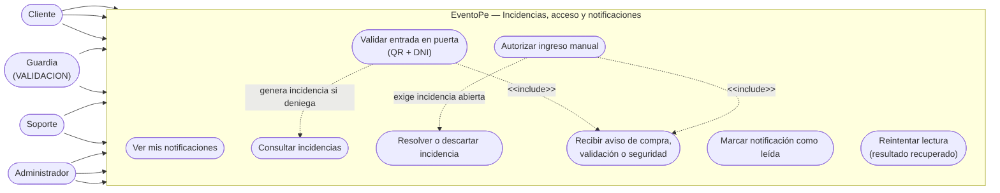
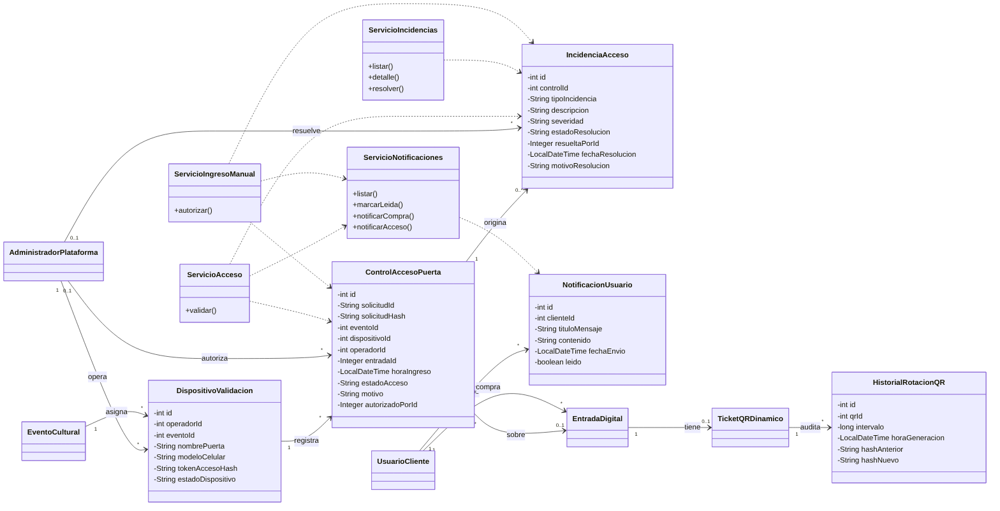
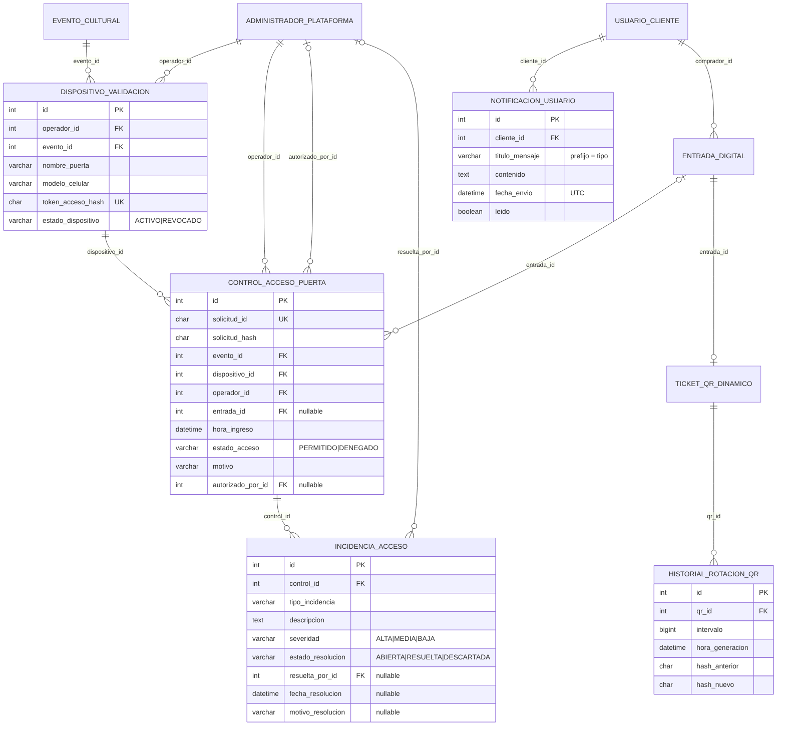
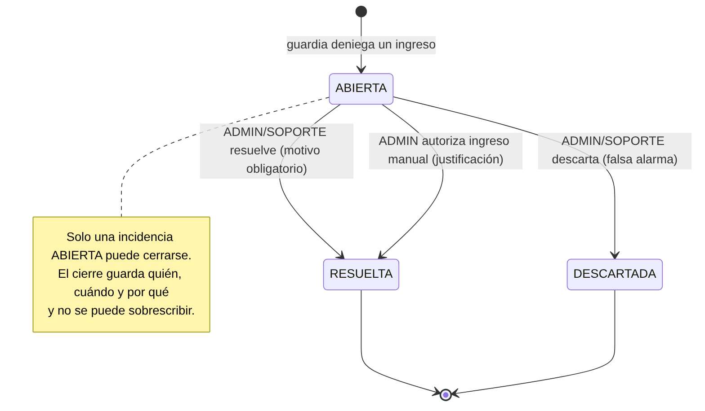
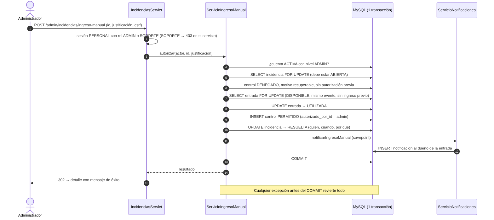
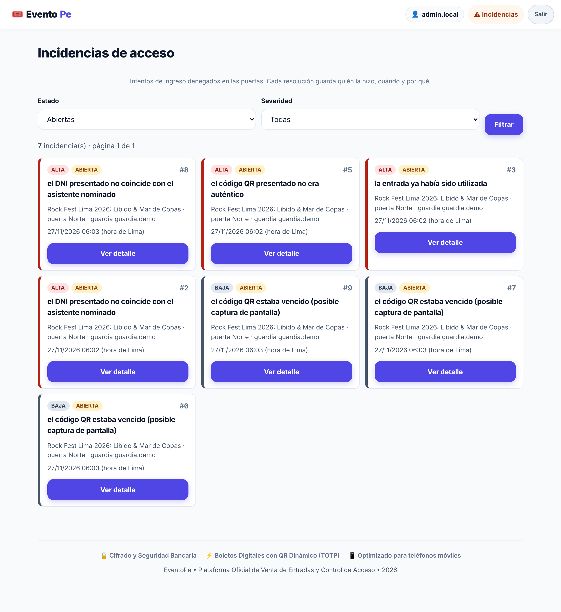
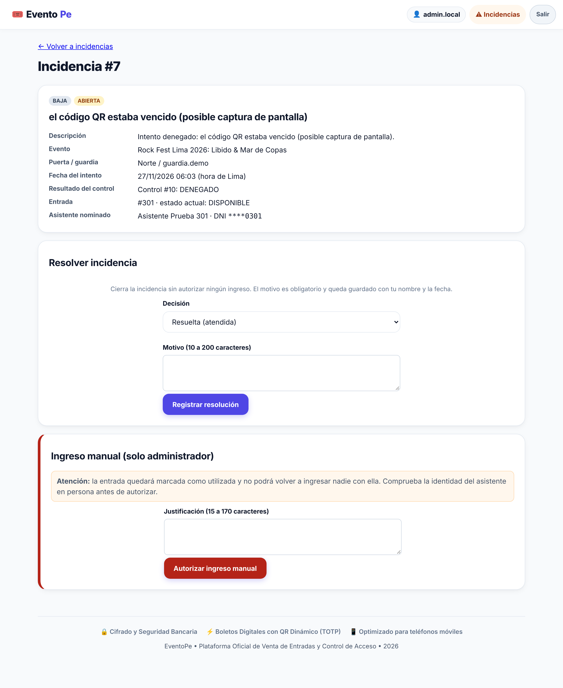
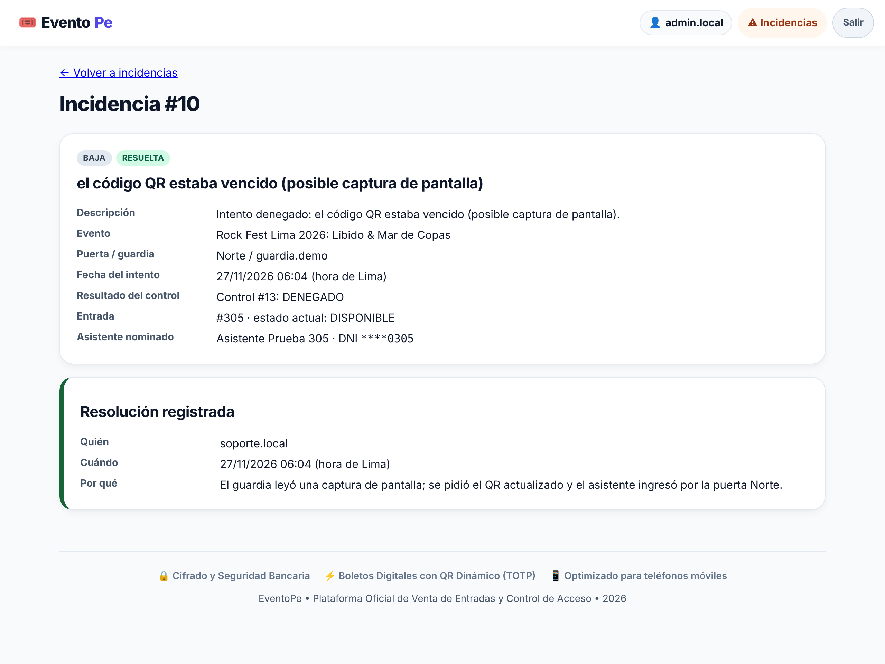
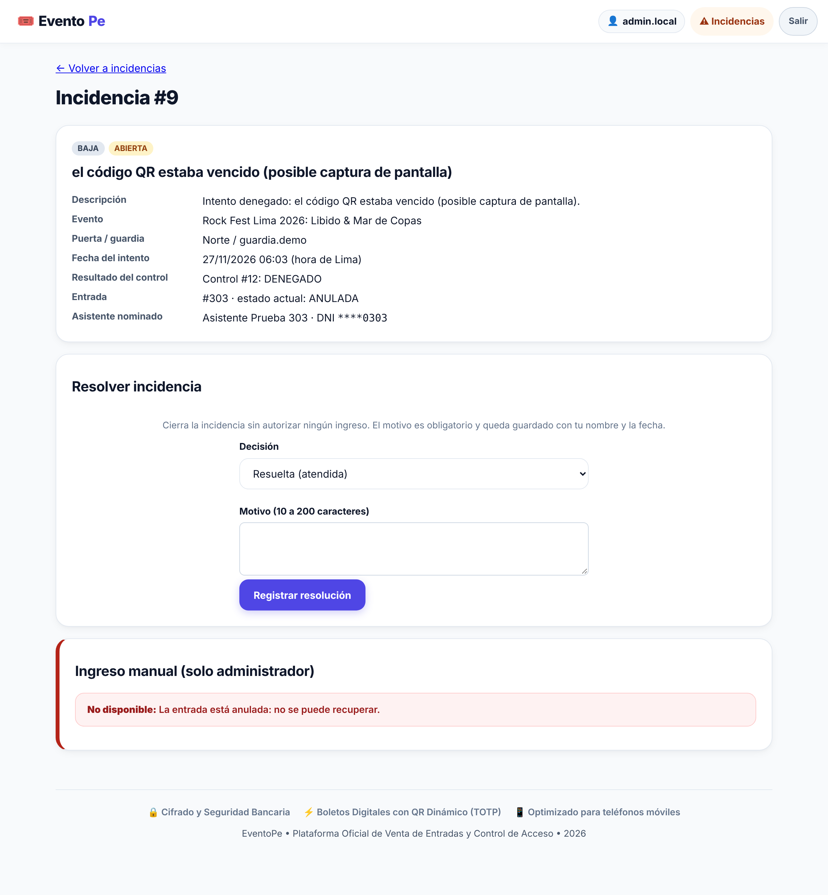
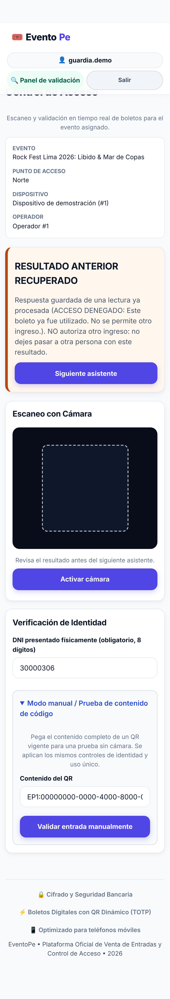

# 1. Alcance de la sección

Esta sección documenta el módulo de **resolución de incidencias y notificaciones** de EventoPe y la verificación del módulo de cámara. Entregables cubiertos:

| Entregable | Estado | Dónde |
|---|---|---|
| Panel para consultar y resolver incidencias (quién, cuándo, por qué) | Hecho y probado | `/admin/incidencias` |
| Ingreso manual justificado, solo ADMIN, con autorización registrada, sin doble ingreso ni recuperar entradas anuladas | Hecho y probado | `ServicioIngresoManual` |
| Notificaciones internas de compra, validación y seguridad | Hecho y probado | `ServicioNotificaciones` |
| Bandeja donde cada cliente ve solo lo suyo y marca como leído | Hecho y probado | `/notificaciones` |
| Indicación clara de resultado anterior recuperado (no autoriza otro ingreso) | Hecho | `seguridad.js` |
| Prueba de cámara en celulares reales con HTTPS | **Pendiente: requiere teléfonos reales** | Guía y plantilla en `04_*` y `05_*` |

# 2. Diseño

No se modificó el esquema de base de datos: todas las columnas necesarias ya existían en `incidencia_acceso`, `control_acceso_puerta` y `notificacion_usuario`.

## 2.1 Incidencias

Cuando `ServicioAcceso.validar` deniega un ingreso, se crea una incidencia con severidad y descripción reales (`MotivosAcceso`): ALTA para QR alterado, entrada ya utilizada o identidad que no coincide; BAJA para QR vencido; MEDIA para el resto. Los usuarios ADMIN y SOPORTE pueden listarlas (filtros por estado y severidad, 20 por página, abiertas primero) y cerrarlas como RESUELTA o DESCARTADA con un motivo de 10 a 200 caracteres. El cierre guarda quién (`resuelta_por_id`), cuándo (`fecha_resolucion`) y por qué (`motivo_resolucion`), y solo se aplica si la incidencia sigue ABIERTA, por lo que un cierre no se puede sobrescribir. El rol se vuelve a comprobar en la base de datos en cada operación (cuenta ACTIVA y rol exacto), de modo que una sesión antigua de una cuenta desactivada deja de funcionar.

## 2.2 Ingreso manual

Es exclusivo del administrador y exige una justificación de 15 a 170 caracteres. Todo ocurre en una sola transacción:

Reglas que se aplican (cada una tiene prueba automática):

- La incidencia debe estar ABIERTA y el intento original DENEGADO, sin autorización previa.
- Solo se admiten motivos recuperables: QR vencido o fuera de intervalo, identidad no coincide, sin nominación, QR no emitido. Los motivos de fraude (QR alterado, entrada ya utilizada) **no** admiten ingreso manual.
- La entrada debe estar DISPONIBLE y ser del mismo evento: una entrada ANULADA o UTILIZADA nunca se recupera ni se duplica.
- Se consume la entrada, se registra un control PERMITIDO con `autorizado_por_id` = administrador y un `solicitud_id` determinista derivado de la incidencia (reintentos idempotentes), y se resuelve la incidencia.
- Dos administradores a la vez (prueba con 10 hilos): solo uno logra el ingreso. Ante cualquier fallo se hace rollback completo.

## 2.3 Notificaciones

Tres tipos, identificados por prefijo en el título: **Compra**, **Validación** y **Seguridad**. Los textos no contienen QR, DNI ni código de entrada. Los emisores son métodos estáticos que se ejecutan dentro de la transacción del llamador protegidos con *savepoint*: si crear el aviso falla, la compra o el ingreso **no** se cancelan. El aviso de compra es idempotente. Las fechas se guardan en UTC y se muestran en hora de Lima.

La bandeja filtra siempre por `cliente_id` de la sesión: un cliente nunca ve ni puede marcar avisos ajenos (un id ajeno responde 404). Permite marcar uno o todos como leídos y el encabezado muestra el contador de no leídos.

## 2.4 Resultado anterior recuperado

Si el guardia reintenta tras perder conexión y el servidor devuelve un resultado ya registrado, la pantalla lo muestra como tarjeta ámbar «RESULTADO ANTERIOR RECUPERADO», aclarando que **no autoriza otro ingreso**.

# 3. Conexión con otros módulos

- **Compra (Ethan):** el aviso de compra se engancha con 3 líneas marcadas `[Glenn]` en `ServicioCompra`, entregadas como `ethan_notificacion_compra.patch` para que Ethan las revise e integre. El módulo funciona sin ellas (solo faltaría el aviso de compra).
- **Acceso:** una línea añadida en `ServicioAcceso` y un cambio mínimo en `AccesoDAO.incidencia()`.
- **Login (Frank):** hoy `autorizarPersonal` solo acepta VALIDACION; para entrar al panel con ADMIN o SOPORTE el login debe aceptar esos roles. No se creó ningún acceso alterno.

# 4. Pruebas

Detalle en `03_pruebas.md`. Resumen: 36 pruebas nuevas, suite completa 113 correctas / 0 fallos (2 no ejecutadas por ser opcionales); 75/75 comprobaciones HTTP contra Tomcat real; matriz 5 válidos / 5 vencidos / 5 usados / 5 alterados, donde solo los válidos permiten ingreso.

# 5. Evidencias

{width=40%}

{width=40%}

**Aviso de honestidad:** estas capturas se tomaron con Chromium (Playwright) a 1280 px y emulando un Pixel 5, no con celulares físicos. Las pruebas en teléfonos reales deben registrarse en `evidencias/plantilla_celulares.md`.

# 6. Limitaciones conocidas

1. Cámara sin probar en celulares reales (ver guía HTTPS).
2. Pruebas ejecutadas sobre MariaDB 10.11; falta repetir `mvn clean verify` en MySQL 8.
3. El acceso de ADMIN/SOPORTE depende del login de Frank.
4. `web.xml` mantiene `cookie-config secure=false`; con HTTPS conviene ponerlo en `true` (coordinar con quien administre la configuración).
